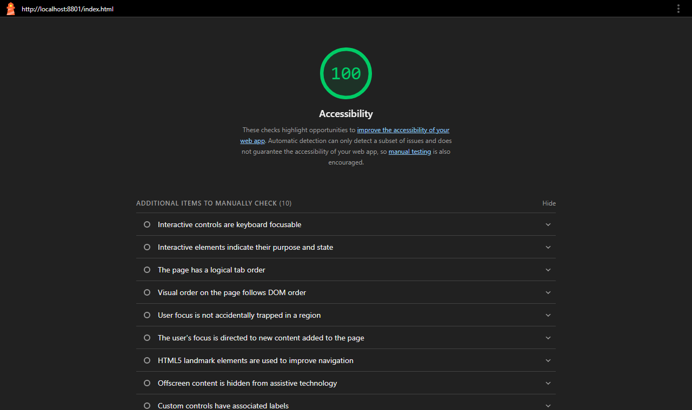
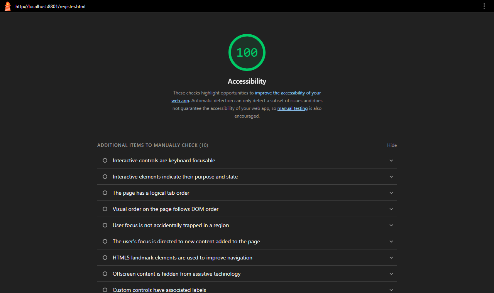

# Club Events

Team project for **MIS 457 Web Based Application Programming** (Fall 2026).

A website where students can see student club events and register for them.

## Team

- Hamza Talha Koşak
- Enes Kaan Duran
- Bedirhan Bayır

## Pages

- `index.html` - home page
- `register.html` - registration form

## Week 4: Fetch and async/await

- `data.json` - the event data (moved out of the HTML)
- `app.js` - loads `data.json` with `fetch` and `async/await`, then makes the event cards
- The page shows four states: **loading**, **success**, **empty** and **error**
- Live search by event or club name

Open the site with Live Server. `fetch` does not work if you open the file with a double click.

## Lighthouse Accessibility

Home page:

Register page:

